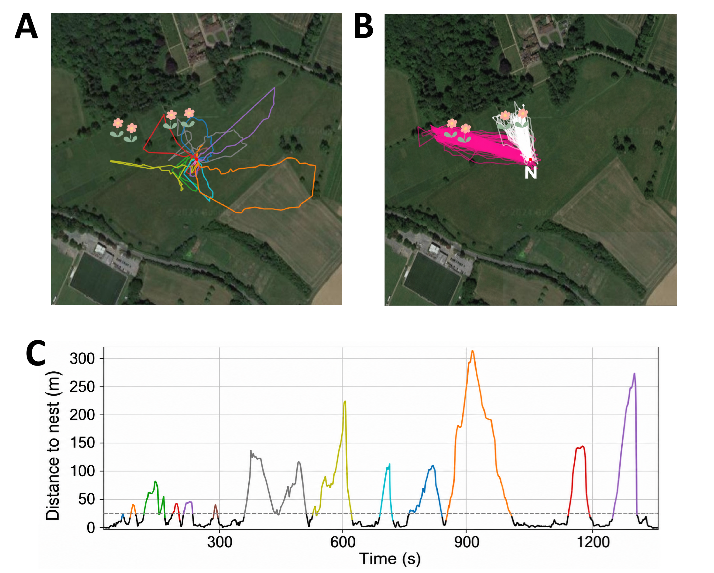
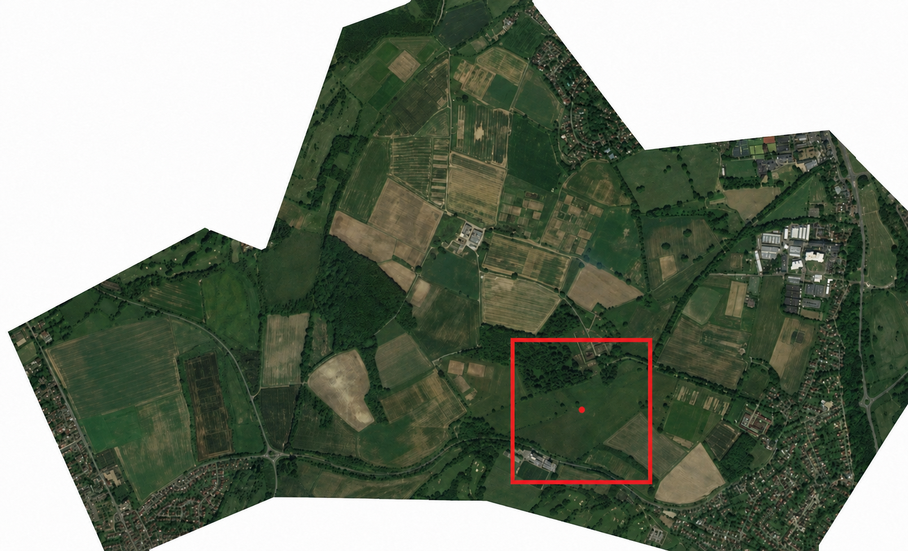
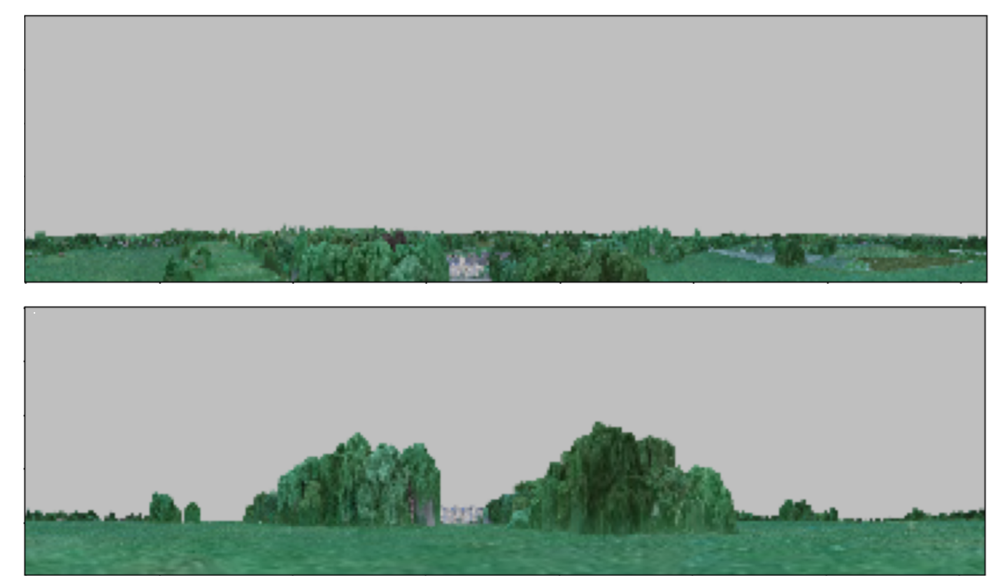
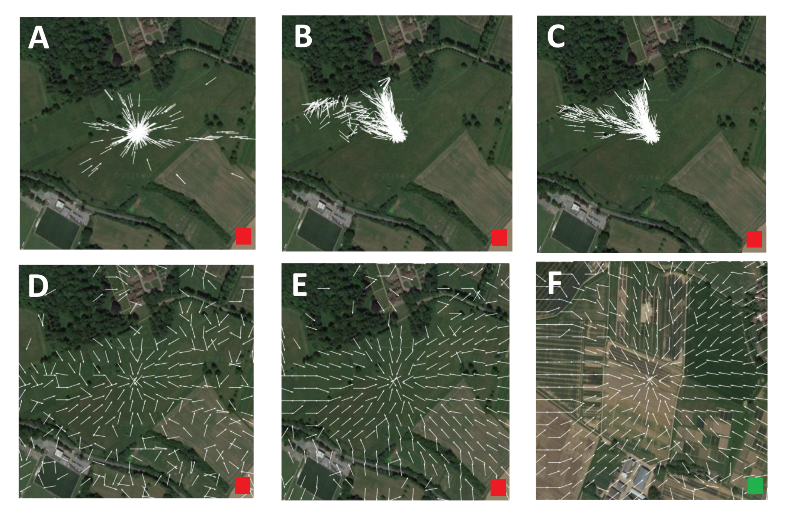
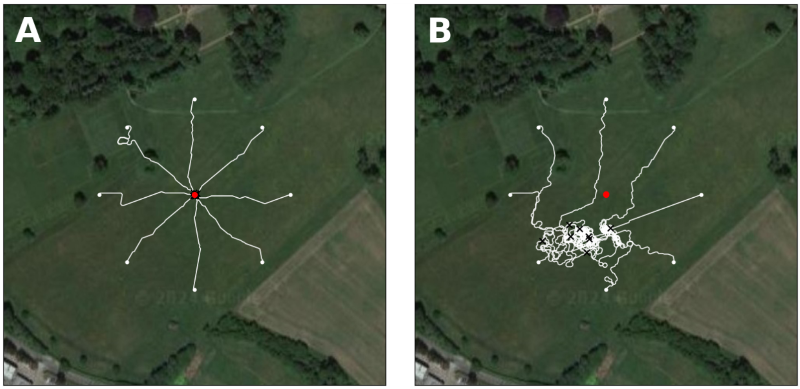

# Insect-inspired visual homing in a 3D environment

This repository contains the simulation and analysis code for [**Misiek, Philippides & Knight (SAB 2024)**](https://doi.org/10.1007/978-3-031-71533-4_2). We test whether panoramic visual memories acquired during a bumblebee's first exploration flights can support long-range homing, and how flight altitude affects performance.

## Bumblebee flight data

[Woodgate et al. (2016)](https://doi.org/10.1371/journal.pone.0160333) used harmonic radar to follow individual bumblebees at Rothamsted Research (UK). We use the recorded two-dimensional trajectories of **Bee 1**, which made **156 flights** (14 exploratory and 142 exploitative). The model learns from the first three exploration flights and is tested on subsequent foraging locations. Because radar did not record flight height, altitude is varied in the simulation.

<p align="center"></p>
<p align="center"><em>Figure 1. Bee 1 flight trajectories and exploration data used to select training and testing locations. Data from Woodgate et al. (2016).</em></p>

## Reconstructed 3D environment

We use a detailed **6 km²** 3D reconstruction of the Rothamsted landscape, based on aerial imagery and made available by [Woodgate (2019)](https://doi.org/10.6084/m9.figshare.7539851.v1). The original mesh was simplified for rendering, while retaining the landscape geometry and textures. A surrounding low-detail terrain model extends the horizon. The simulation renders **360° panoramic views** from arbitrary positions and heights.

<p align="center"></p>
<p align="center"><em>Figure 2. Aerial view of the Rothamsted 3D environment used in the simulations.</em></p>

<p align="center"></p>
<p align="center"><em>Figure 3. Example rendered views near Rothamsted Manor, illustrating how the visual scene changes with flight height.</em></p>

## Visual navigation

The model stores **335 nest-facing panoramic snapshots** selected from Bee 1's early exploration flights. At a test position, it rotates the current view against these memories and chooses the heading with the smallest image difference—a simple **snapshot-based visual compass**.

<p align="center"></p>
<p align="center"><em>Figure 4. Illustrative homing vector field: predicted directions toward the remembered nest location.</em></p>

The published study evaluates directional predictions at the bee's recorded foraging locations and on spatial grids (**open-loop tests**). The following image illustrates an additional closed-loop navigation experiment, in which successive predictions are used to guide movement.

<p align="center"></p>
<p align="center"><em>Figure 5. Example closed-loop visual homing simulation (illustrative; separate from the SAB 2024 open-loop results).</em></p>

**Main findings:** the visual compass can predict homeward headings from distances of up to **300 m**; higher flight altitudes generally improve long-range performance; and memories transfer poorly between substantially different altitudes.

## Installation

```bash
git clone https://github.com/thomasMisiek/Bumblebee_Rothamsted_SAB2024.git
cd Bumblebee_Rothamsted_SAB2024
pip install -r requirements.txt
```

Alternatively, use `conda env create -f environment.yml` followed by `conda activate Bumblebee_Rothamsted_SAB2024`. See `docs/` for usage instructions.

## References

- **Misiek, T., Philippides, A., & Knight, J. (2024).** *Insect-Based Navigation Model Allows Efficient Long-Range Visual Homing in a 3D Simulated Environment.* From Animals to Animats 17 (SAB 2024), LNCS 14993, pp. 15–26. [DOI: 10.1007/978-3-031-71533-4_2](https://doi.org/10.1007/978-3-031-71533-4_2).
- **Woodgate, J. L., et al. (2016).** *Life-Long Radar Tracking of Bumblebees.* PLOS ONE 11(8), e0160333. [DOI: 10.1371/journal.pone.0160333](https://doi.org/10.1371/journal.pone.0160333).
- **Woodgate, J. (2019).** *3D model of an agricultural research institute.* Figshare. [DOI: 10.6084/m9.figshare.7539851.v1](https://doi.org/10.6084/m9.figshare.7539851.v1).

**Authors:** Thomas Misiek, Andrew Philippides, James Knight · **Contact:** [t.misiek@sussex.ac.uk](mailto:t.misiek@sussex.ac.uk)
